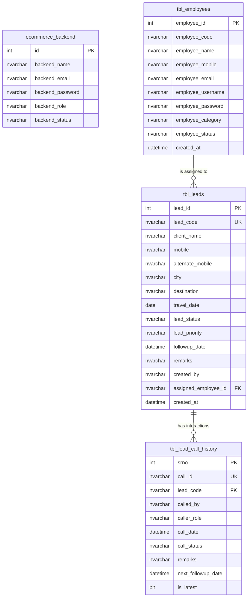

# 🌍 New Journey Holidays CRM (NJ-CRM)

> **Enterprise Tourism & Travel Agency Lead Management & Telecalling Operations System**  
> Built with **ASP.NET Web Forms (C# / .NET Framework 4.8.1)** & **Microsoft SQL Server**.

---

## 📋 Table of Contents
1. [Overview](#-overview)
2. [Key Capabilities & Business Value](#-key-capabilities--business-value)
3. [Technology Stack & Architecture](#-technology-stack--architecture)
4. [System Architecture & Portals](#-system-architecture--portals)
   - [1. Admin Management Portal (`/admin`)](#1-admin-management-portal-admin)
   - [2. Employee & Telecalling Portal (`/employee`)](#2-employee--telecalling-portal-employee)
5. [Database Schema & Data Model](#-database-schema--data-model)
6. [Core Workflows & Business Logic](#-core-workflows--business-logic)
7. [Directory Structure](#-directory-structure)
8. [Getting Started & Installation](#-getting-started--installation)
   - [Prerequisites](#prerequisites)
   - [Database Configuration](#database-configuration)
   - [Running with IIS Express / Visual Studio](#running-with-iis-express--visual-studio)
   - [Login Endpoints & Access](#login-endpoints--access)
9. [Security & Data Integrity](#-security--data-integrity)
10. [UI & UX Design System](#-ui--ux-design-system)

---

## 🌟 Overview

**New Journey Holidays CRM** is a dedicated travel industry Customer Relationship Management and Lead Operations platform. It centralizes customer vacation inquiries, automates lead assignment across sales and telecalling teams, logs customer call histories with next follow-up dates, and monitors conversion pipelines in real time.

The system is organized into a **Dual-Portal Architecture**:
* **Admin Portal**: Executive oversight, bulk lead assignment, employee administration, reports, and global lead repository.
* **Employee Portal**: Tailored workspace for telecallers and sales executives to manage their assigned inquiries, conduct calls, log remarks, and track personal monthly conversion goals.

---

## 🚀 Key Capabilities & Business Value

* **Inquiry Lifecycle Management**: From lead intake (`LEAD-0001`) to qualification, package negotiation, follow-ups, and booking confirmation.
* **Lead Attribution Guarantee**: The original creator (`created_by`) is permanently retained regardless of how many times a lead is reassigned, ensuring commissions and performance credits are protected.
* **Bulk & Single Lead Assignment**: Admins can assign batches of leads to staff with a single click, or instantly unassign mistaken assignments via confirmation modals.
* **Telecalling & Follow-up Queue**: Dedicated daily queues showing calls due today with automated next follow-up scheduling.
* **Chronological Interaction History**: Complete audit trail of every phone call, outcome status, and note recorded by telecallers.
* **Responsive Web Experience**: Tailored for both desktop workstations and mobile devices so telecallers can log inquiries on the move.

---

## 🛠 Technology Stack & Architecture

| Layer | Technologies Used |
| :--- | :--- |
| **Framework** | ASP.NET Web Forms (C#), .NET Framework 4.8.1 |
| **Web Server** | IIS Express / Microsoft IIS 8.0+ |
| **Database** | Microsoft SQL Server (LocalDB / Express / Standard) |
| **Data Access** | ADO.NET (`SqlConnection`, `SqlCommand`, `SqlDataAdapter`, `SqlTransaction`) |
| **Security** | AES-256 Rijndael/CryptoStream (`Encrypt.cs`), ASP.NET Session State |
| **Front-End** | Bootstrap 5.3, Bootstrap Icons, JavaScript (ES6+), Custom CSS3 |
| **Architecture** | N-Tier Layered Architecture with central helper service (`Master.cs`) |

---

## 🖥 System Architecture & Portals

### 1. Admin Management Portal (`/admin`)

Designed for branch managers, team leads, and system administrators:

| Page | File | Key Features |
| :--- | :--- | :--- |
| **Executive Dashboard** | `admin/Dashboard.aspx` | Real-time counts for Total Leads, Confirmed, Pending, Hot leads, Total Staff, and Today's Due Calls. Recent inquiries table and quick shortcuts. |
| **Master Lead Directory** | `admin/AllLeads.aspx` | Searchable grid with multi-filter support (Status, Priority, Destination). Integrated Bootstrap modals to view details, update lead fields, log calls, and delete records. |
| **Lead Intake Form** | `admin/AddLead.aspx` | Full-form client intake (contact numbers, city, holiday destination, planned travel date, priority, remarks, and initial owner assignment). |
| **Bulk Lead Distribution** | `admin/AssignLeads.aspx` | Multi-select checkboxes with Select-All, responsive toolbar, target staff picker, and inline **Unassign** button with modal confirmation. |
| **Employee Roster** | `admin/Employees.aspx` | Staff CRUD with auto-generated username (`onkeyup`), role/category assignment (Sales, Telecalling, Support), password management, and active status switch. |
| **Employee Roles** | `admin/EmployeeCategories.aspx` | Role & category taxonomies for organizational structuring. |
| **Follow-up Pipeline** | `admin/FollowUps.aspx` | Calendar-driven list of scheduled client follow-ups across the entire organization. |
| **Call Interaction Logs** | `admin/CallHistory.aspx` | System-wide log of telecaller customer interactions, call outcomes, and caller details. |
| **Analytics & Reports** | `admin/Reports.aspx` | Conversion statistics, inquiry volume trends, and team productivity reports. |
| **Admin Authentication** | `admin/Login.aspx` | Secure session initiation via `ecommerce_backend` credentials. |

---

### 2. Employee & Telecalling Portal (`/employee`)

Tailored for telecallers and holiday sales executives:

| Page | File | Key Features |
| :--- | :--- | :--- |
| **Staff Dashboard** | `employee/Dashboard.aspx` | Personal metrics: My Field Leads, Active Leads, Today's Calls, Monthly Calls, Assigned Leads, and Monthly Target Progress. Features the **Today's Follow-ups Queue** with one-click call buttons. |
| **My Leads Workspace** | `employee/MyLeads.aspx` | Filterable list of inquiries owned by or assigned to the logged-in employee. Includes Quick Call and Edit modal interactions. |
| **Lead Details & Timeline** | `employee/LeadDetails.aspx` | Complete customer profile, itinerary requirements, chronological interaction history, and new call logging form. |
| **Field Intake Form** | `employee/Add-Lead.aspx` | Mobile-friendly lead entry for executives capturing walk-ins or on-the-field inquiries. |
| **Personal Call History** | `employee/CallHistory.aspx` | Chronological record of all client calls logged by the employee. |
| **Profile & Settings** | `employee/MyProfile.aspx` | View profile details and update employee credentials. |
| **Staff Authentication** | `employee/Employee_Login.aspx` | Sign-in supporting either username or email with password verification. |

---

## 🗄 Database Schema & Data Model

The application operates against the `NJCRM` database containing 4 primary relational tables:



### Table Definitions

#### 1. `tbl_leads` (Customer Travel Inquiries)
* `lead_id` *(INT, Identity)*: Primary Key.
* `lead_code` *(NVARCHAR(20))*: Formatted identifier (e.g. `LEAD-0001`).
* `client_name`, `mobile`, `alternate_mobile`, `city`: Customer contact details.
* `destination` *(NVARCHAR(150))*: Holiday destination or tour package (e.g., Char Dham, Kashmir, Dubai, Bali).
* `travel_date` *(DATE)*: Intended travel/departure date.
* `lead_status` *(NVARCHAR(30))*: Current stage (`New`, `Pending`, `Interested`, `Confirmed`, `Lost`).
* `lead_priority` *(NVARCHAR(20))*: Urgency classification (`Hot`, `Warm`, `Cold`).
* `followup_date` *(DATETIME)*: Next scheduled contact date & time.
* `remarks` *(NVARCHAR(500))*: Intake remarks or special client requests.
* `created_by` *(NVARCHAR(100))*: Original owner/creator (permanent attribution).
* `assigned_employee_id` *(NVARCHAR(100))*: ID of the staff member currently handling the lead (`NULL` if unassigned).
* `created_at` *(DATETIME)*: Timestamp of registration.

#### 2. `tbl_lead_call_history` (Interaction Audit Trail)
* `srno` *(INT, Identity)*: Primary Key.
* `call_id` *(NVARCHAR(20))*: Unique timestamp-based call ID (`CALL-yyMMddHHmmssfff`).
* `lead_code` *(NVARCHAR(20))*: Associated lead code foreign reference.
* `called_by` *(NVARCHAR(100))*: Name of the employee or admin making the call.
* `caller_role` *(NVARCHAR(20))*: Staff role (`Admin`, `Employee`, `Sales`).
* `call_date` *(DATETIME)*: Exact timestamp of the call.
* `call_status` *(NVARCHAR(30))*: Outcome (`Connected`, `Busy`, `Call Back`, `Interested`, `Converted`, `Not Reachable`).
* `remarks` *(NVARCHAR(500))*: Notes from the phone conversation.
* `next_followup_date` *(DATETIME)*: Rescheduled follow-up timestamp.
* `is_latest` *(BIT)*: 1 for the most recent interaction, 0 for historical logs.

#### 3. `tbl_employees` (Staff & Telecallers)
* `employee_id` *(INT, Identity)*: Primary Key.
* `employee_code` *(NVARCHAR(20))*: Staff code (e.g. `EMP-001`).
* `employee_name` *(NVARCHAR(100))*: Full legal name.
* `employee_mobile`, `employee_email`: Contact coordinates.
* `employee_username` *(NVARCHAR(50))*: Portal login handle.
* `employee_password` *(NVARCHAR(255))*: Secure login secret.
* `employee_category` *(NVARCHAR(50))*: Department/Skill (`Sales`, `Telecalling`, `Field Executive`).
* `employee_status` *(NVARCHAR(20))*: Access state (`Active`, `Inactive`).
* `created_at` *(DATETIME)*: Joining/Registration date.

#### 4. `ecommerce_backend` (Administrative Users)
* `id` *(INT, Identity)*: Admin identifier.
* `backend_name`, `backend_email`, `backend_password`: Admin credentials.
* `backend_role` *(NVARCHAR)*: Permission role (`Admin`, `SuperAdmin`).
* `backend_status` *(NVARCHAR)*: Account state (`Active`, `Suspended`).

---

## ⚡ Core Workflows & Business Logic

### 1. Atomic Call Logging & Follow-up Synchronization
Whenever a telecaller or admin records a customer call:
1. An atomic SQL transaction (`SqlTransaction`) is initialized in `Master.insert_call_history()`.
2. Existing records for the `lead_code` in `tbl_lead_call_history` have `is_latest` set to `0`.
3. The new interaction is inserted with a generated `call_id` and flagged with `is_latest = 1`.
4. The parent `tbl_leads.followup_date` is simultaneously updated to match `next_followup_date`.
5. If any step fails, the transaction rolls back, guaranteeing zero orphaned or out-of-sync logs.

### 2. Auto-Formatted Lead Identifiers
* The `getlead_code()` utility inspects `SELECT ISNULL(MAX(lead_id), 0) + 1 FROM dbo.tbl_leads`.
* Automatically outputs consistent alphanumeric identifiers: `LEAD-0001`, `LEAD-0002`, etc.

### 3. Bulk & Individual Lead Assignment
* **Bulk Assignment**: Admins select multiple leads with checkboxes. Submitting the assignment updates `assigned_employee_id` across all selected codes in one operation while keeping `created_by` intact.
* **Unassignment**: An assigned lead can be detached using the dedicated **Unassign** button in `AssignLeads.aspx`, clearing `assigned_employee_id` back to `NULL` (`Unassigned Queue`).

---

## 📁 Directory Structure

```text
CRM-NJ/
├── App_Code/
│   ├── Encrypt.cs                # AES-256 encryption & decryption utilities
│   └── Master.cs                 # Central DAL & business logic operations
│
├── admin/                        # Management & Administrative Portal
│   ├── css/
│   │   └── admin-style.css       # Admin dashboard & UI styles
│   ├── images/
│   │   └── logo.png              # Brand logo
│   ├── AddLead.aspx (.cs)        # Lead intake form
│   ├── AllLeads.aspx (.cs)       # Full lead directory with search & edit
│   ├── AssignLeads.aspx (.cs)    # Bulk lead distribution & unassignment
│   ├── CallHistory.aspx (.cs)    # Call interaction audit logs
│   ├── Dashboard.aspx (.cs)      # Executive metrics & KPI dashboards
│   ├── EmployeeCategories.aspx (.cs) # Department/Category taxonomy
│   ├── Employees.aspx (.cs)      # Staff management & credentials
│   ├── FollowUps.aspx (.cs)      # Follow-up scheduling calendar
│   ├── Login.aspx (.cs)          # Admin portal authentication
│   ├── MasterPage.master (.cs)   # Admin branded layout & sidebar
│   ├── Register.aspx (.cs)       # Admin account creation
│   ├── Reports.aspx (.cs)        # Conversion & performance analytics
│   └── Settings.aspx (.cs)       # CRM configuration options
│
├── employee/                     # Telecaller & Sales Staff Portal
│   ├── css/
│   │   └── employee-style.css    # Employee workspace styling
│   ├── images/
│   │   └── logo.png              # Brand logo
│   ├── Add-Lead.aspx (.cs)       # Employee on-field lead creation
│   ├── CallHistory.aspx (.cs)    # Personal call records
│   ├── Dashboard.aspx (.cs)      # Calling KPIs & daily follow-up queue
│   ├── Employee_Login.aspx (.cs) # Staff authentication endpoint
│   ├── FollowUps.aspx (.cs)      # Employee-specific follow-ups
│   ├── LeadDetails.aspx (.cs)    # Detailed lead profile & call log history
│   ├── MasterPage.master (.cs)   # Employee branded layout & sidebar
│   ├── MyLeads.aspx (.cs)        # Assigned lead inventory & quick actions
│   └── MyProfile.aspx (.cs)      # Staff account profile & password
│
├── images/                       # Shared holiday destination assets & banners
├── Web.config                    # Connection strings & runtime configuration
├── Web.Debug.config              # Debug transformation settings
└── README.md                     # Comprehensive project documentation
```

---

## 🚀 Getting Started & Installation

### Prerequisites
* **Operating System**: Windows 10 / Windows 11 / Windows Server 2016+
* **IDE**: Microsoft Visual Studio 2019 / 2022 (with *ASP.NET and web development* workload)
* **Runtime**: .NET Framework 4.8.1
* **Database**: Microsoft SQL Server 2016+ or SQL Server Express / LocalDB

---

### Database Configuration

1. Open your SQL Server instance (or `(localdb)\MSSQLLocalDB`).
2. Create the target database:
   ```sql
   CREATE DATABASE NJCRM;
   ```
3. Verify or update the connection string in [Web.config](file:///d:/Visual%20Projects/CRM-NJ/Web.config):
   ```xml
   <connectionStrings>
     <add name="DefaultConnection"
          connectionString="Data Source=(localdb)\MSSQLLocalDB;Initial Catalog=NJCRM;Integrated Security=True;Encrypt=False;TrustServerCertificate=True;"
          providerName="System.Data.SqlClient" />
   </connectionStrings>
   ```

---

### Running with IIS Express / Visual Studio

#### Option A: Using Visual Studio
1. Open Visual Studio.
2. Go to **File** ➔ **Open** ➔ **Web Site...** (or Open Folder).
3. Select `d:\Visual Projects\CRM-NJ`.
4. Set `admin/Login.aspx` or `employee/Employee_Login.aspx` as the Start Page.
5. Press **F5** or click **IIS Express (Google Chrome / Edge)**.

#### Option B: Using PowerShell & IIS Express CLI
```powershell
# Navigate to IIS Express installation
cd "C:\Program Files\IIS Express"

# Launch CRM-NJ on local port 8196
.\iisexpress.exe /path:"d:\Visual Projects\CRM-NJ" /port:8196
```
Open your browser and navigate to:
* Admin: `http://localhost:8196/admin/Login.aspx`
* Employee: `http://localhost:8196/employee/Employee_Login.aspx`

---

### Login Endpoints & Access

| Portal | URL Route | Target Audience |
| :--- | :--- | :--- |
| **Admin Portal** | `/admin/Login.aspx` | Branch Admins, Team Leads, Management |
| **Employee Portal** | `/employee/Employee_Login.aspx` | Telecallers, Holiday Sales Executives |

---

## 🔒 Security & Data Integrity

* **Parameterized SQL Queries**: All queries in `Master.cs` and code-behind files use `SqlCommand.Parameters.AddWithValue` or explicit types to eliminate SQL Injection vulnerabilities.
* **Transaction Safety**: Multi-table updates (such as inserting call logs and synchronizing the lead's next follow-up date) execute inside `SqlTransaction` with rollback safeguards.
* **Cryptographic Service**: `App_Code/Encrypt.cs` provides AES encryption with PBKDF2 key derivation (`Rfc2898DeriveBytes`) for sensitive attributes.
* **Session Isolation**: Admin and Employee portals manage distinct session variables (`Session["id"]` vs `Session["employee_id"]`) to prevent privilege escalation.

---

## 🎨 UI & UX Design System

* **Brand Palette**:
  * Primary Green: `#166534` (Tailwind Emerald 800)
  * Dark Accent: `#134e4a` (Deep Pine)
  * Highlight Success: `#198754` (Bootstrap Success)
  * Priority Badges: **Hot** (Red-subtle), **Warm** (Orange-subtle), **Cold** (Cyan-subtle)
* **Component Styling**:
  * Modern cards with soft borders (`border-success border-opacity-25`).
  * Modal overlays for fast editing without losing grid scroll position.
  * Responsive table containers with horizontal scroll support on smaller screens.
  * Clean typography with Bootstrap 5 native font stacks.

---

## 📄 License & Attribution

* **Client / Organization**: New Journey Holidays CRM
* **Maintained By**: Development & Operations Team
* **Internal Documentation**: Version 1.0 (November 2026)

